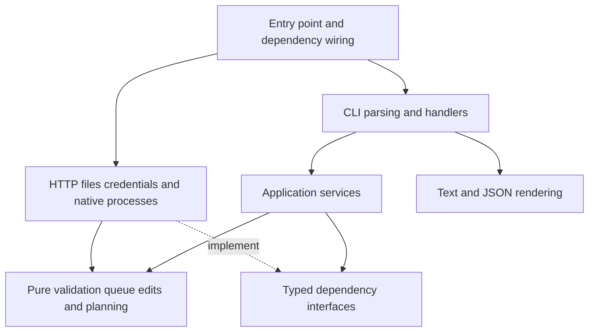

# GOG Achievements CLI TypeScript Migration Report

14 October 2026. Baseline: `main`, commit `a102216760b555b2a864ed18c853f256ef484920`, version `0.3.0`.

The CLI is suitable for a strict TypeScript migration. Its existing module boundaries and tests provide a good base. The main work is to type external data, preserve command contracts, and adapt the build. The main architecture improvements are to extract pure queue rules and separate them from file access and account operations.

Use two stages: first establish strict types and verify matching behaviour; then improve the module boundaries. Keep each stage independently testable and reversible. This report is the review point before implementation.

## Verified baseline

The CLI has 14 source modules, with 2,216 lines, and 10 test files. It exposes 14 commands. It has no production npm dependencies. The desktop app runs a packaged executable and validates its JSON responses.

Checks on macOS with Node `24.19.0`:

| Check                   | Result                                                                  |
| ----------------------- | ----------------------------------------------------------------------- |
| `npm run check`         | Passed syntax, JSON, ESLint and Prettier checks.                        |
| `npm run test:coverage` | Passed all 87 tests.                                                    |
| Measured coverage       | 98.28% lines, 91.28% branches, 96.36% functions.                        |
| JSON help               | Passed; version, 14 commands and exit codes confirmed.                  |
| `npm run demo`          | Passed the fixture workflow, including preview, apply and repeat apply. |

The HTTP timeout test needed localhost access outside the sandbox. The first run failed with `listen EPERM`; the complete rerun passed. Coverage describes the files measured by the current runner. `src/index.mjs` is absent from that coverage report.

Native executable builds and live sign-in were not run for this report. The four platform builds are configured in CI; their current remote results were not checked. The desktop app's uncommitted work remains separate from this assessment.

## Existing strengths

- `service.mjs` is independent of argument parsing and output rendering. It already accepts API, credential store, clock and delay dependencies.
- `help.mjs` defines commands and flags in one place. Parsing and help share these definitions.
- `output.mjs` formats results without network calls. It removes terminal control characters from readable output.
- Queue validation, file locks and atomic file operations already protect local changes.
- Apply validates the whole queue before writing, reads again before each write, preserves existing unlocks, and reconciles lost responses without repeating the POST.
- Native process limits, cancellation, private pipes, credential storage and helper verification have dedicated tests.

## Findings

No critical or high runtime defect was confirmed in this review. The findings below concern type safety, separation of responsibilities and migration risks.

| Severity | Location and review pass                                                                                                                                                                                                                                                                                                                                                                                                                   | Finding and action                                                                                                                                                                                                                                                                                    |
| -------- | ------------------------------------------------------------------------------------------------------------------------------------------------------------------------------------------------------------------------------------------------------------------------------------------------------------------------------------------------------------------------------------------------------------------------------------------ | ----------------------------------------------------------------------------------------------------------------------------------------------------------------------------------------------------------------------------------------------------------------------------------------------------- |
| Medium   | [API request](https://github.com/opista/gog-achievements-cli/blob/a102216760b555b2a864ed18c853f256ef484920/src/api.mjs#L26), [queue validation](https://github.com/opista/gog-achievements-cli/blob/a102216760b555b2a864ed18c853f256ef484920/src/data.mjs#L95), [native response](https://github.com/opista/gog-achievements-cli/blob/a102216760b555b2a864ed18c853f256ef484920/src/native-login.mjs#L69). Bad practices and type checking. | External JSON has no static contract. Existing runtime checks provide useful protection. Make decoded data `unknown`, refine it with validators, and return explicit types. A type assertion alone must not establish trust.                                                                          |
| Medium   | [CLI dispatch](https://github.com/opista/gog-achievements-cli/blob/a102216760b555b2a864ed18c853f256ef484920/src/cli.mjs#L64), [output dispatch](https://github.com/opista/gog-achievements-cli/blob/a102216760b555b2a864ed18c853f256ef484920/src/output.mjs#L324). Logic and pattern improvements.                                                                                                                                         | The command name and result payload have no enforced relationship. A command can return the wrong data shape without a static error. Use a discriminated command union and a result map so each formatter receives its expected payload.                                                              |
| Medium   | [Service](https://github.com/opista/gog-achievements-cli/blob/a102216760b555b2a864ed18c853f256ef484920/src/service.mjs#L23). Pattern improvements.                                                                                                                                                                                                                                                                                         | One class handles authentication, session refresh, catalogue reads, queue edits, planning and remote restoration. Keep the exported class as a compatibility facade. Extract queue transformations and restoration planning into pure functions; isolate session management behind a small interface. |
| Medium   | [Data module](https://github.com/opista/gog-achievements-cli/blob/a102216760b555b2a864ed18c853f256ef484920/src/data.mjs#L1), [CLI input](https://github.com/opista/gog-achievements-cli/blob/a102216760b555b2a864ed18c853f256ef484920/src/cli.mjs#L23). Pattern improvements and operation ordering.                                                                                                                                       | Pure validation shares a module with filesystem effects. CLI dispatch also owns stdin, clipboard, signals and queue file transactions. Separate validation from file storage. Move process input and login lifecycle handling into focused adapters, while preserving each lock's current scope.      |
| Medium   | [Check runner](https://github.com/opista/gog-achievements-cli/blob/a102216760b555b2a864ed18c853f256ef484920/scripts/check.mjs#L4), [test runner](https://github.com/opista/gog-achievements-cli/blob/a102216760b555b2a864ed18c853f256ef484920/scripts/test.mjs#L4). Logic and migration coverage.                                                                                                                                          | Checks and test discovery scan flat `.mjs` folders. Coverage selects `src/*.mjs`. New TypeScript files or nested modules could escape these gates. Make discovery recursive, verify the measured file list, and add an import check for the public entry point.                                       |
| Low      | [Login timeout](https://github.com/opista/gog-achievements-cli/blob/a102216760b555b2a864ed18c853f256ef484920/src/cli.mjs#L131), [native timeout](https://github.com/opista/gog-achievements-cli/blob/a102216760b555b2a864ed18c853f256ef484920/src/native-login.mjs#L87). Magic values.                                                                                                                                                     | Related timeout defaults and input limits occur in several modules. Share named policy constants where they express the same rule. Keep their current values and distinguish seconds from milliseconds.                                                                                               |

The operation-order review found explicit guards before achievement writes and cleanup in `finally` blocks for locks and login signal handlers. The security review found deliberate masking of raw process, filesystem and HTTP errors. Keep these controls during extraction. The inspected JavaScript contains no SQL access.

## Proposed architecture

Use a functional core with small adapters for external effects. Pure functions accept data and return data. Application functions control the sequence of reads and writes. Keep local mutation where it makes that sequence clear, particularly in restoration.

| Area           | Responsibility                                                                                                                                                         |
| -------------- | ---------------------------------------------------------------------------------------------------------------------------------------------------------------------- |
| `domain/`      | Validated IDs and dates, queue validation and transformations, restoration planning, and domain errors. No filesystem, process or HTTP imports. Pass time as an input. |
| `application/` | Session management, ownership checks, queue use cases, and ordered apply/readback logic. Depend on small API and credential interfaces.                                |
| `adapters/`    | GOG HTTP calls and decoding, queue files and locks, credential storage, native login, process execution, stdin and clipboard access.                                   |
| `cli/`         | Command definitions, parsing, typed handlers, help and output. Parsing and formatting remain pure. Handlers invoke application operations and local file transactions. |
| Entry points   | Assemble dependencies and connect output to stdout/stderr. Preserve the existing exported functions, classes and method behaviour.                                     |

Keep contracts with their owning modules and use type-only imports. Preserve the single command definition source with `as const` and `satisfies`. Enforce import direction with ESLint. Name utility modules by purpose, such as queue validation or date conversion.

The existing dependency injection is sufficient. Add an interface when it describes a real boundary used by production and test code. The API and native credential classes can remain stateful adapters.

## TypeScript policy

Use TypeScript ESM sources. Prefer `.mts` because the project already uses `.mjs`; `.mts` emits `.mjs` and makes the module format explicit. Use `module: NodeNext`, `moduleResolution: NodeNext`, explicit relative import extensions and a fixed JavaScript target compatible with Node 22. These rules follow [TypeScript's Node module guidance](https://www.typescriptlang.org/docs/handbook/modules/reference.html#node16-node18-node20-nodenext).

Enable `strict`, `noUncheckedIndexedAccess`, `exactOptionalPropertyTypes`, `noImplicitReturns`, `noFallthroughCasesInSwitch`, `verbatimModuleSyntax` and `noEmitOnError`. Pin compatible compiler and Node type versions in the lockfile. The [strict option](https://www.typescriptlang.org/tsconfig/strict.html), [indexed access checks](https://www.typescriptlang.org/tsconfig/noUncheckedIndexedAccess.html) and [exact optional properties](https://www.typescriptlang.org/tsconfig/exactOptionalPropertyTypes.html) cover different gaps.

Add TypeScript ESLint rules for explicit `any`, unsafe assignments/access, floating promises and exhaustive switches. `strict` alone does not prevent `JSON.parse` from introducing `any`. The [unsafe assignment rule](https://typescript-eslint.io/rules/no-unsafe-assignment/) detects that path; [switch checks](https://typescript-eslint.io/rules/switch-exhaustiveness-check/) help keep command and status handling complete. Use narrow guards for caught errors. Keep assertions limited to justified boundaries such as branding a value after validation.

Define explicit types for:

- Internal sessions and game credentials, separate from public account and game data. Construct public payloads explicitly.
- Validated decimal IDs and requested unlock dates. Preserve the existing acceptance of safe numeric IDs at input boundaries; returned IDs remain strings.
- Observed remote dates, whose current validation differs from queue request dates.
- Queue schema version `1`, readonly queue inputs, and transformations that return new values.
- Locked and unlocked achievements, tying `unlocked` to nullable `unlocked_at`.
- All seven restoration statuses and their valid result fields.
- Parsed commands, command-specific success data, errors, exit codes and native helper events.
- API, credential store, clock, delay and process dependencies, including their test doubles.

Keep runtime validators. Preserve their accepted inputs, coercions, error codes and validation order. Fields currently passed through without a specific shape, such as `works_on` and `rarity`, should remain `unknown` until validated. Introduce a schema library only if it offers a clear benefit over the existing validators.

## Build and compatibility requirements

Compile before execution and packaging. Keep the existing esbuild and native packaging flow, with a separate mandatory type check. [esbuild removes TypeScript annotations but does not check types](https://esbuild.github.io/content-types/#typescript).

Use one ignored output root, for example `.build/typescript/`, with a mirrored source/test layout. Run emitted JavaScript tests with Node's existing test runner. Keep source maps and verify that coverage still measures application code. Package runtime files and declarations explicitly; exclude tests from release distributions.

Preserve `node bin/gog-achievements.mjs` through a small JavaScript launcher and preserve the package's named exports through an ESM compatibility entry. Compile application code, tests and fixtures. Build scripts can migrate in a separate change; any retained JavaScript bootstrap or configuration must be small and checked. Source development gains an explicit compile step, documented in the setup commands. Installed executables retain their current requirements.

Native type stripping is unsuitable as the sole execution path for the declared `node >=22` range: it was added in 22.6 and enabled by default in 22.18. It also performs no type checking. See [Node 22 TypeScript support](https://nodejs.org/docs/latest-v22.x/api/typescript.html).

Three build details need explicit tests:

1. [Helper paths](https://github.com/opista/gog-achievements-cli/blob/a102216760b555b2a864ed18c853f256ef484920/src/assets.mjs#L66) depend on `import.meta.url`. Define root/path resolution for emitted source execution, the single executable and the Intel Mac private runtime layout. Check the package JSON import used for version detection too.
2. [Build validation](https://github.com/opista/gog-achievements-cli/blob/a102216760b555b2a864ed18c853f256ef484920/scripts/build.mjs#L116) rejects target mismatches before filesystem changes. Keep that check before any compilation that writes output. Build help and invalid targets must also work outside the checkout.
3. The build embeds a CommonJS bundle and replaces `import.meta.url`. Preserve that packaging behaviour, helper asset names, archive layout, metadata and checksum rules.

## Behaviour that must remain the same

| Contract                     | Required preservation                                                                                                                                                                       |
| ---------------------------- | ------------------------------------------------------------------------------------------------------------------------------------------------------------------------------------------- |
| Commands and output          | All 14 commands, flags, help, readable defaults, JSON envelopes, indentation, newline behaviour and stdout/stderr routing.                                                                  |
| Errors                       | Existing public codes, messages, exit codes `0`, `2`–`7`, and incomplete reports under `error.details.report`.                                                                              |
| Queue files                  | Schema `1`, string IDs, unknown-field rejection, duplicate rules, date rules, ten-second default offset, second precision, file permissions, atomic creation/replacement and lock lifetime. |
| Remote operations            | Ownership and account checks, complete paging, redirect rejection, bounded responses/timeouts, preview by default and writes only with `--yes`.                                             |
| Restoration                  | Whole-queue validation, sequential writes, final reread, skip existing unlocks, one POST per attempt, reconciliation, date mismatch reporting and stop-on-failure behaviour.                |
| Authentication               | Exact registered redirect, state checks, cancellation, window closure, private IPC, bounded credential access and existing storage identities.                                              |
| Integration and distribution | Public JavaScript API behaviour, executable names, four target layouts, build metadata, archives and release publication gates.                                                             |

The desktop app is a useful independent contract reference: its [CLI client](/Users/beau/Documents/projects/gog-achievements/src/main/cli-client.ts:13) invokes the executable, and its [schemas](/Users/beau/Documents/projects/gog-achievements/src/shared/schemas.ts:41) validate payloads. Preserve this process boundary. Use fixture contract tests against those expectations without adding a dependency on the app's source or changing its worktree.

## Implementation sequence

1. **Capture compatibility evidence.** Freeze time and fixture data. Record command results, rendered output, queue bytes, exit codes and API request order. Add public-export and emitted-path checks. Use synthetic credentials throughout.
2. **Establish the compiler and execution path.** Add compiler configuration, lint support and explicit compile/type-check commands. Prove ESM imports, package version lookup, helper paths and recursive test/coverage discovery on a small slice. Keep native build validation ahead of writes.
3. **Migrate the existing modules.** Add explicit boundary contracts and strict types while keeping the current structure. Migrate tests and fixtures, including malformed inputs. Add compiler checks that reject incorrect command payloads and nullable requested dates. Compare results and effects against stage 1. Keep unexpected behaviour changes separate for review.
4. **Extract the functional core.** Move queue validation, edits and planning into pure modules. Separate file transactions and session management. Keep the service facade and restore sequence stable. Repeat the same compatibility comparisons after each extraction.
5. **Verify distribution.** Run code checks, coverage, demo and the native build for the current OS/architecture. Require all four native CI builds, callback/storage self-tests, executable smoke checks outside the checkout and release artifact verification before release.

Compare exact output where deterministic. Normalize only explicit test variables, such as temporary paths and clock values. Compare request traces as well as return values: identical JSON alone does not prove identical write behaviour.

## Completion criteria

- All existing scenarios pass, with added checks for type boundaries, public exports and emitted execution paths.
- The compiler and lint checks pass without broad `any` types, blanket suppressions or unvalidated payload casts.
- The coverage thresholds remain at least 95% lines, 85% branches and 90% functions. Review any reduction from the measured baseline and confirm that the file denominator has not shrunk accidentally.
- Domain modules have no external effects. Import rules enforce the intended direction.
- CLI, queue, authentication and restoration contracts match the captured baseline. Automated tests use fixtures and local servers.
- All four native target builds and distribution checks pass. Live browser sign-in and real server date limits remain separate manual checks.

The first priorities are typed boundary validation, command-to-result typing, and a proven compile/test/package path. Extract the queue core after those controls are in place.
